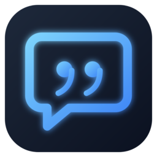

<div align="center">
  
  <h1>Recallr 💬</h1>
  <p><strong>Your AI interview assistant, from prep to follow-up</strong></p>
</div>

<br/>

**Recallr** is a free desktop app that helps you prepare for job interviews, suggests answers during the call, and reviews how it went afterwards. Answers are built only from your own resume, the job description and the answers you prepared, and they're written the way a person talks, not like an AI.

It runs on [Groq](https://groq.com) (fast and free to start) or OpenAI: speech-to-text with Whisper, answers in about a second.

## ✨ Features

### Before the interview
- **Profiles**: one per application ("Shopify – Tech Lead", "Amazon – SDE III"), each with its own resume, job description, company notes and prepared answers.
- **Prepared answers**: import them from a file, start from common questions, or draft them from your resume. When a matching question comes up, your own answer is used.
- **Questions from the job description**: one click predicts the 8–12 questions this job will most likely bring up, with answers drafted from your resume.
- **Story bank**: pulls 5–8 real stories from your resume (a hard problem, a conflict, a failure, leading a project...) for behavioural questions.
- **Company notes**: paste your research so answers like "Why us?" mention real details.
- **Mock interview**: questions read out loud, you answer on your microphone, and each answer gets a score, feedback and a stronger version.
- **Pre-interview check**: tests your keys, answer speed, microphone, call audio and screen reading in about 15 seconds.

### During the interview
- **Live answers**: hears the call audio, waits for the interviewer to finish, and streams an answer in natural spoken English.
- **Hear both sides**: "Call + mic" mode also hears your microphone, so Recallr knows what you actually said.
- **Answer controls**: Regenerate, Shorter, Longer, Simpler or More technical.
- **Key points view**: the answer as 3–4 short cues, for a quick glance.
- **Likely follow-ups**: the questions you'll probably get next, with a hint for each.
- **Code answers**: coding and SQL questions get a highlighted code block.
- **Read from screen**: picks the interview question out of everything on your screen (a coding problem, a chat message) and answers it.
- **Type a question** at any time.
- **Overlay**: floats above other apps, with separate background and text opacity, light and dark themes, and adjustable text size.
- **Keyboard shortcuts** that work in any app (⌃⌥ on macOS, Ctrl+Alt+Shift on Windows/Linux): **L** listen, **A** ask, **R** regenerate, **N** new conversation, **S** read from screen.

### After the interview
- **History**: every conversation is saved; search it and reopen any of them.
- **Interview review**: what was asked, weak spots, what to prepare next, and a thank-you email draft.
- **Export**: save a conversation (and its review) as PDF or Markdown.

## 🚀 Quick Start (Download)

1. **Download the installer** from the [Releases](../../releases) page.
2. **Get a free Groq API key** at [console.groq.com](https://console.groq.com/keys) (or use an OpenAI key).
3. **Set it up:**
   - Open the app and paste your API key.
   - Upload your resume and paste the job description.
   - Optionally add prepared answers.
   - Run the **pre-interview check**, then press **Listen**.

## 🛠️ Development

If you want to build from source or contribute:

### Prerequisites
- Node.js 18+
- npm or yarn

### Installation

```bash
cd recallr

# Install dependencies
npm install

# Start the development server
npm run dev
```

### Build for Production

```bash
# Compile and build the Electron installer
npm run dist
```
The installer will be generated inside the `dist-installers` folder.

## ❓ FAQ

**1. Is it free?**
The app is free and open source. You need a Groq or OpenAI API key; Groq has a free tier that is enough for most people.

**2. Where is my data stored?**
On your computer only: settings, profiles and keys in the app's local storage, and past conversations as files in the app's data folder. There is no Recallr server. To get answers, the text of the conversation, your resume and the job description are sent to the AI provider you chose (Groq or OpenAI), and audio is sent to it for speech-to-text.

**3. What should I put in the resume and job description?**
Paste the full text of both, or upload your resume as a PDF. Formatting doesn't matter. The more complete they are, the more specific the answers.

**4. How can I try it without a real interview?**
Use the **Mock interview**, or press **Listen** and play a mock interview video on YouTube.

**5. It isn't hearing the call. What do I check?**
Run the **pre-interview check**. On macOS, Recallr needs "System Audio Recording" permission (System Settings → Privacy & Security → Screen & System Audio Recording) to hear the call, and Screen Recording permission for "Read from screen". Restart the app after changing permissions.

**6. Why does it take a moment to answer?**
It waits until the interviewer pauses so it answers the whole question, not half of it. Answers then start in about a second with Groq; the pre-interview check shows your actual speed.

**7. Does it work on Mac, Windows and Linux?**
The release builds are for Windows. On macOS and Linux, clone the repository and run `npm run dist` to build it.

---

## 📝 License

Distributed under a Custom Non-Commercial License. You are free to use and study the software, but **commercial distribution or sale is strictly prohibited**. See `LICENSE` for more information.
